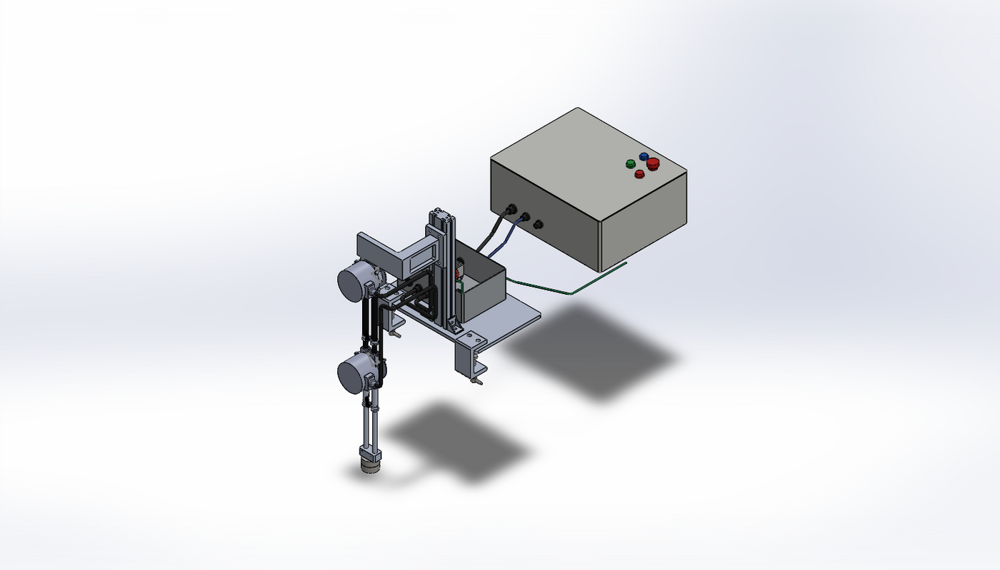
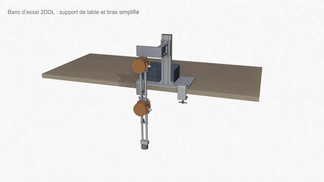
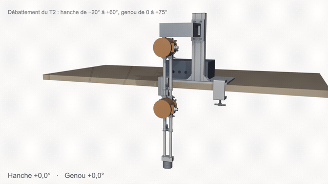

# Vigol Brayann Fofie

Élève ingénieur en 5e année de **mécatronique et robotique** à JUNIA HEI (Lille). Je conçois des systèmes mécatroniques de bout en bout : dimensionnement, conception mécanique, électronique, commande et simulation, firmware embarqué.

**Je recherche un stage de fin d'études** en robotique, en systèmes embarqués ou en commande.

## Projets

### Stabilisation par roues de réaction d'un robot monowheel

Projet associatif CRYSTEO (JUNIA), octobre 2025 à aujourd'hui · **[voir le dépôt](https://github.com/vigol2025/reaction-wheel-monowheel)**

Robot mascotte en équilibre sur une seule roue, stabilisé par quatre roues de réaction à 45°.

  

- **Dimensionnement et revue de conception** : 3,3 N·m pour corriger 10° en 0,4 s ; le calcul a montré, avant tout essai, que le moteur acheté était 6 à 12 fois trop faible pour le robot final, d'où un banc d'essai qui valide la commande avec ce moteur
- **Banc d'essai à deux axes** : CAO générée par du code Python, contrôlée (interférences sur ±20° en roulis et en tangage), puis reconstruite dans SolidWorks par son API avec ses contraintes posées automatiquement ; câblage dessiné aux longueurs mesurées ; équilibrage statique ; dossier technique de 41 pages et carnet de commandes
- **Jumeaux numériques Simscape et Webots** : commande d'attitude avec observateur sur chaque axe, allocation sur quatre roues, boucles de vitesse, perception, interface de pilotage au manche ; inclinaison tenue à 0,05° près, poussée rattrapée en 0,3 s
- **Boucle matérielle** : Simulink pilote en temps réel le vrai moteur à travers un ESP32 (protocole tramé, armement, failsafe)
- **Firmware ESP32** : driver du capteur BNO055, commande des ESC, PID deux axes à 200 Hz sous FreeRTOS ; modèle système Capella

### Banc d'essai d'exosquelette pédiatrique, hanche et genou

Projet de fin d'études, JUNIA HEI, septembre 2026 à janvier 2027 · équipe de 4 · **[voir le dossier du projet](exosquelette-banc-2ddl/README.md)**

Banc à deux degrés de liberté qui reproduit l'actionnement de l'exosquelette pédiatrique INES (moteurs maxon, réducteurs Harmonic Drive, contrôleurs EPOS4), pour que l'équipe de recherche y mette au point sa commande.

  

  
  

- **Mon rôle : conception mécanique et câblage, en binôme.** Conception sous SolidWorks (192 pièces, assemblages par liaisons, 14 mises en plan), dimensionnement, nomenclature et carnet de commandes chiffré
- Câblage : schéma électrique normalisé (12 folios), projet KiCad, plan de câblage
- Contribution à l'ensemble du projet : état de l'art, cahier des charges, cinématique, planification
- Avancement : conception et dossiers réalisés, fabrication et assemblage à venir ; banc opérationnel prévu en janvier 2027

*Projet de recherche JUNIA : seules des vues et des plans sont publiés, pas les fichiers CAO ni les schémas complets. Je le présente volontiers en entretien.*

## Compétences

| Domaine | Outils et méthodes |
| --- | --- |
| Commande et simulation | MATLAB/Simulink, Simscape Multibody, Webots ; PID, observateurs d'état, allocation de couple ; essais en boucle matérielle |
| Embarqué et temps réel | C++ sur ESP32 (PlatformIO, FreeRTOS), I2C, PWM, liaison série tramée |
| Conception mécanique | SolidWorks (assemblages par liaisons, mises en plan, automatisation par l'API), CAO paramétrique en Python, impression 3D |
| Électrique | KiCad, schémas électriques normalisés, plans de câblage |
| Logiciel | Python (automatisation, Matplotlib), Git |
| Ingénierie système | Capella (méthode Arcadia), cahier des charges, niveaux de maturité (TRL), planification |

---

*In English: final-year mechatronics and robotics engineering student at JUNIA HEI (Lille, France), looking for an end-of-studies internship in robotics, embedded systems or control. Projects: reaction-wheel stabilisation of a monowheel robot, with a two-axis test rig, Simscape and Webots digital twins and ESP32 firmware ([repository](https://github.com/vigol2025/reaction-wheel-monowheel)); mechanical design and wiring of a hip-knee test bench for a paediatric exoskeleton (final-year project).*
