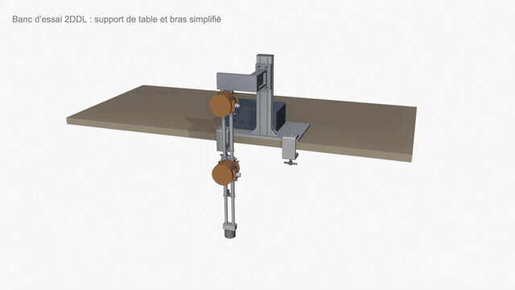
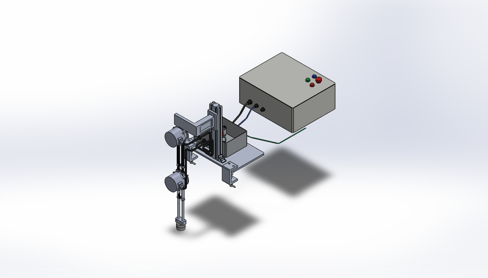
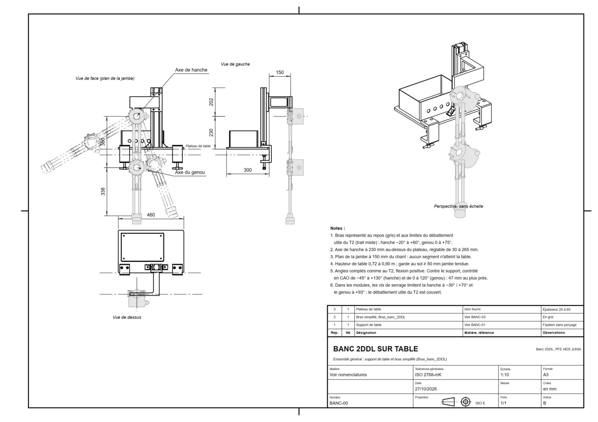
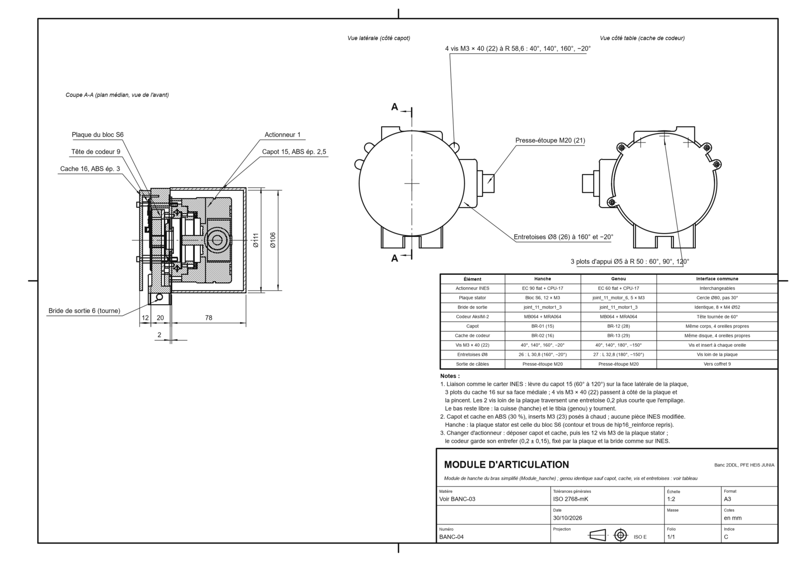
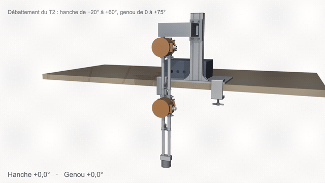
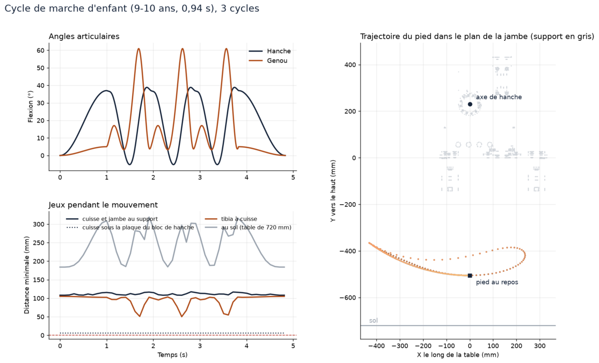
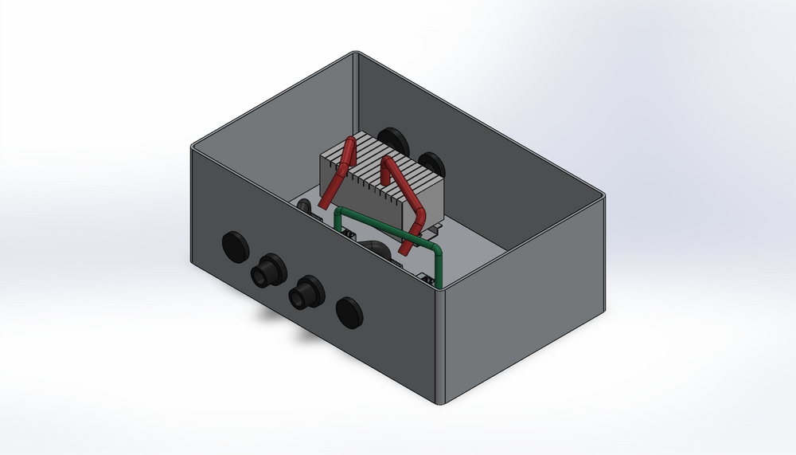
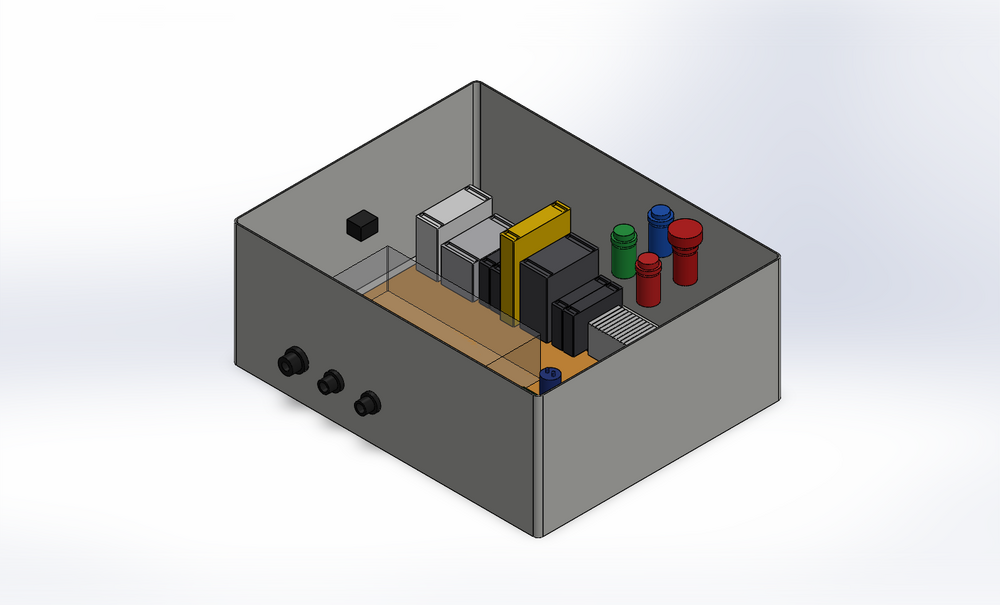
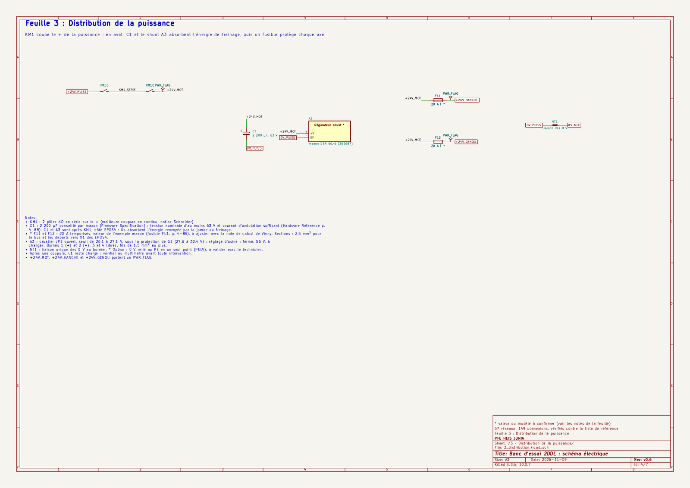

# Banc d'essai 2 DDL pour l'exosquelette pédiatrique INES (hanche et genou)

Projet de fin d'études, JUNIA HEI (Lille), septembre 2026 à janvier 2027 · équipe de 4

Ce banc à deux degrés de liberté reproduit à l'identique l'actionnement, l'instrumentation et la commande de l'exosquelette pédiatrique **INES**. Il permettra à l'équipe de recherche de mettre au point la **commande en couple** de la hanche et du genou sur table, avant les essais sur l'exosquelette lui-même.

  

| | |
| --- | --- |
| **Mon rôle** | Responsable électronique, actionnement et instrumentation ; conception mécanique et câblage en binôme |
| **Actionnement** | Moteurs maxon EC 90 flat (hanche) et EC 60 flat (genou), réducteurs Harmonic Drive CPU-17, 2 contrôleurs EPOS4 Compact 50/15 en EtherCAT, codeurs absolus RLS AksIM-2 (SSI) |
| **Commande** | Cible temps réel Speedgoat, MATLAB/Simulink |
| **Outils** | SolidWorks (assemblages par liaisons, mises en plan), KiCad 10, QElectroTech, Blender pour les rendus |
| **Avancement** | Conception mécanique et électrique terminées, dossiers livrés ; fabrication et assemblage à venir, banc opérationnel prévu fin janvier 2027 |

## Le banc

  

Le bras reprend les modules d'articulation d'INES (moteur, réducteur, codeur) sur un support qui se fixe sans perçage sur une table. La hanche est portée par un **bloc usiné dans la masse** (aluminium 6061 T6) qui coulisse sur une colonne pour régler la hauteur d'axe. Le tibia est amovible sans outil.

  

- **Environ 190 pièces**, assemblées dans SolidWorks par liaisons (une seule pièce fixe par assemblage, pivots de hanche et de genou libres avec butées).
- **14 mises en plan** des pièces fabriquées, cotées dans SolidWorks, et un dossier de fabrication complet.
- **Débattement vérifié en CAO** : hanche de −20° à +60° et genou de 0 à +75° sans contact avec le support.

  

## Étude de mouvement

  

Le bras a été animé dans SolidWorks sur trois trajectoires : le débattement du cahier des charges, une marche d'enfant de 9 à 10 ans à vitesse réelle et une marche ralentie. L'étude a fait ressortir un point à trancher avant les essais : à vitesse réelle, la hanche doit tourner à environ **202 °/s**, au-delà des **190 °/s à vide** de son moteur sous 24 V.

  

## Électronique et câblage

  
  &nbsp;
  

- **Architecture à deux coffrets** : les deux EPOS4 au plus près du bras, l'alimentation et la sécurité dans un coffret de puissance posé sur la table.
- **Chaîne d'arrêt d'urgence de catégorie 0** sur deux canaux (relais de sécurité, contacteur à contact miroir), reliée à l'entrée STO des EPOS4.
- **Schéma KiCad 10** en 6 feuilles hiérarchiques (alimentation, sécurité, distribution, axe hanche, axe genou, communication), contrôle électrique sans erreur ni avertissement.
- **Schéma électrique normalisé** de 12 folios A3, **plan de câblage** des deux coffrets fil par fil, et **CAO du câblage** dans SolidWorks.

  

## Pilotage du projet

- État de l'art et cahier des charges (tâches 1 et 2), conception (tâche 3), présentation de 37 diapositives.
- **Carnet de commandes** en 5 lots, chiffré (budget des commandes fermes ≈ 2 400 € HT).
- Planification PERT et Gantt pour un banc opérationnel fin janvier 2027.

## Prochaines étapes

1. Commandes, fabrication des pièces usinées et impression des capots.
2. Assemblage mécanique, câblage des coffrets, contrôles avant mise sous tension.
3. Mise en service des EPOS4 en EtherCAT avec la cible Speedgoat, premiers essais en couple sur la hanche puis le genou.

---

*Projet de recherche JUNIA (exosquelette INES). Ce dépôt présente le banc à travers des vues et des plans ; les fichiers CAO, les schémas complets et les documents de l'équipe de recherche ne sont pas publiés.*

*In English: final-year project at JUNIA HEI. A two-degree-of-freedom hip-knee test bench that reproduces the actuation (maxon EC flat motors, Harmonic Drive gears, EPOS4 over EtherCAT, AksIM-2 encoders) and the Speedgoat real-time control of the INES paediatric exoskeleton, so the research team can tune its torque control on a table. My role: electronics, actuation and instrumentation lead; mechanical design and wiring in a pair.*
